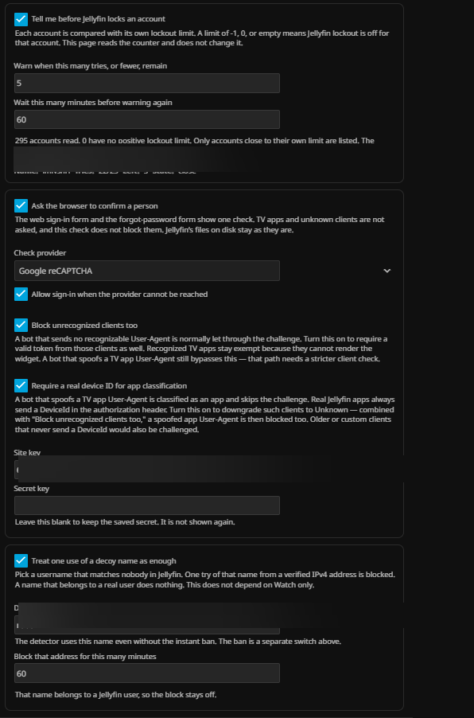

# Jelly Security

**Jelly Security** إضافة لـ Jellyfin 12.2. تراقب تسجيل الدخول، وتحتفظ بسجلاتها، وتستطيع إبطاء بعض طلبات الدخول أو إيقافها أو حظرها عندما يفعّل المسؤول ذلك.

Jellyfin تبقى هي التي تتحقق من كلمة المرور. الإضافة لا تستبدل المستخدمين ولا كلمات المرور ولا الجلسات. التشغيل لا يُصنَّف ولا يُؤخَّر ولا يُقطع.

| | |
|---|---|
| الإصدار | 0.21.0 |
| Jellyfin | 12.2.0 |
| بيئة التشغيل | .NET 10 (`net10.0`) |
| الاسم في لوحة التحكم | Jelly Security |
| الرخصة | [GPL-3.0-or-later](LICENSE) |

[English](README.md) · [دليل الاستخدام](docs/USER_GUIDE.md) · [الدليل التقني](Jelly_Security.md) · [سجل التغييرات](CHANGELOG.md)

## لقطات

| لوحة التحكم | سجلات النشاط |
|---|---|
|  |  |

| ضوابط تسجيل الدخول | مراقبة الكشف |
|---|---|
|  |  |

| إعدادات CAPTCHA والطُعم | الجلسات |
|---|---|
|  |  |

| نصوص الوكيل | النسخ الاحتياطي والتنبيهات |
|---|---|
|  |  |

| CAPTCHA على صفحة الدخول | قائمة تسجيل الدخول |
|---|---|
|  |  |

## لوحة التحكم

بعد التثبيت تظهر صفحة واحدة باسم **Jelly Security** في قائمة الخادم. الصفحة بالإنجليزية.

تبدأ الصفحة بما يحدث الآن، ثم خيار واحد لكل هدف: إبطاء تخمين كلمة المرور، إيقاف اسم تحت الرش، التنبيه قبل قفل Jellyfin، ملاحظة جلسة غير مألوفة، حظر عنوان، إيقاف عنوان بعد إخفاقات متكررة، سؤال المتصفح أن يؤكد شخصاً، معاملة اسم الفخ كدليل كافٍ، ونسخ حد للوكيل. أرقام الهدف تظهر بعد تشغيله. الأنماط والنسخ الاحتياطي وسجل الدخول تبقى مطوية في الأسفل.

قسم **خط زمني للهجوم** يجمع محاولات الدخول الفاشلة والمحظورة حسب عنوان المصدر في قصص هجوم. كل قصة تعرض تسلسل المحاولات والأنماط المكتشفة وأي حظر طُبّق — بترتيب زمني — ليقرأ المسؤول ما حدث من البداية للنهاية بدل التمرير في قائمة مسطحة.

اللوحة تتحدّث **حياً** عبر Server-Sent Events. عند وقوع حدث دخول أو حظر أو نمط، تتحدّث الصفحة فوراً — بلا انتظار 30 ثانية. إن تعذّر SSE (مثلاً بسبب بروكسي يُؤخّر الاستجابة)، تعود الصفحة للاستطلاع كل 30 ثانية.

حفظ النموذج هو الذي يطبّق التغيير. أغلب الضوابط الإضافية تبدأ مغلقة.

## الضوابط

| الضابط | الافتراضي | ماذا يفعل |
|---|---|---|
| مراقبة فقط | مفعّل | يسجّل الدخول. الحظر التلقائي للعناوين يبقى مغلقاً. |
| الحظر اليدوي | مفعّل | ينفّذ حظر IPv4 وIPv6 وCIDR الذي ينشئه المسؤول. |
| حظر الدول | مغلق | يحظر تسجيل الدخول الذي يطابق عنوانه صفّ دولة يحددها المسؤول. النطاقات نص قابل للتحرير — املأها من ملف geo محلي أو الصقها بنفسك. |
| الحظر التلقائي للعناوين | مغلق | حظر مؤقت فقط عندما يسمح الوضع بذلك ويكون عنوان العميل موثّقاً. |
| تحدي المتصفح | مغلق | Google reCAPTCHA v2 أو Cloudflare Turnstile على نموذج المتصفح ونموذج نسيت كلمة المرور. تطبيقات التلفاز والهاتف لا تُسأل. يمكن تحدي العملاء غير المعروفين أيضاً بخيار اختياري. |
| بصمة الجهاز | مغلق | خيار اختياري لتصنيف أصرم. البوت الذي ينتحل User-Agent لتطبيق تلفاز يُصنّف عادةً كتطبيق ويتجاوز التحدي. تطبيقات Jellyfin الحقيقية ترسل دائماً DeviceId في ترويسة التفويض. عند تفعيله، عميل يدّعي أنه تطبيق بلا DeviceId يُخفّض إلى غير معروف — ومع "تحدي العملاء غير المعروفين" المفعّل، يُتحدّى المنتحل مثل المتصفح. |
| إبطاء كلمة المرور | مغلق | انتظار ثانية ثم ثلاث ثم خمس عند تكرار الإخفاق. السقف قابل للضبط. |
| تهدئة الحساب | مغلق | إيقاف اسم داخل الإضافة بعد رشّ موزع. تنتهي وحدها ولا تعطّل مستخدم Jellyfin. |
| حظر اسم الفخ | مغلق | استخدام واحد لاسم لا يطابق أي مستخدم يمكن أن يحظر عنوان IPv4 الموثّق. |
| مراقبة القفل | مغلق | تقرأ حد القفل وعداد الإخفاق من حساب كل مستخدم. لا تكتب أياً منهما. |
| مراقبة الجلسات | مغلق | تنبيه عند عنوان جديد أو جلسات متزامنة كثيرة. زر يغلق الأجهزة التي لا تشغّل شيئاً. |
| نص الوكيل | مغلق | نص للصق في Nginx أو Caddy أو Cloudflare. الإضافة لا تكتب تلك الملفات. |
| خط زمني للهجوم | مفعّل | يجمع محاولات الدخول الفاشلة والمحظورة حسب عنوان المصدر في قصص زمنية. للقراءة فقط. |
| مراقبة مسح الـ API | مغلق | يعدّ الطلبات الفاشلة وغير الموثّقة على نقاط التعداد (/Users و/Items و/System/Info و/Library) لكل عنوان، لرصد الاستطلاع قبل هجوم الدخول. يسجّل حدث Reconnaissance وحادثاً عند تجاوز العتبات. التشغيل والصور والتنزيلات والملفات الثابتة لا تُعدّ أبداً. |
| إبطاء الماسحات | مغلق | مع المراقبة مفعّلة، العنوان الذي يتجاوز العتبة يحصل على ردود 429 مؤقتة على نقاط التعداد لمدة تهدئة قابلة للضبط. يتطلب عنواناً موثّقاً. شبكات الإدارة والمراقبة والموثوقة لا تُحدّد أبداً. تسجيل الدخول والتشغيل لا يتأثران. |

حد -1 أو 0 أو قيمة فارغة على حساب Jellyfin يعني أن قفل ذلك الحساب متوقف. الإضافة لا تستخدم رقماً ثابتاً للقفل.

## التثبيت

Jellyfin Server 12.2. من لوحة التحكم افتح **Plugins** ثم **Repositories** وأضف مستودعاً:

| | |
|---|---|
| اسم المستودع | Jelly Security |
| عنوان المستودع | https://raw.githubusercontent.com/Rashid-config/Jelly_Security/main/manifest.json |

احفظ المستودع، ثم ارجع إلى الكتالوج وثبّت **Jelly Security**. تطلب Jellyfin إعادة التشغيل قبل أن تظهر الصفحة. اسم الصفحة Jelly Security.

خادم Jellyfin 10.11 يحتاج بناءً منفصلاً. هذا البناء يستهدف `net10.0`.

## السجلات

تحفظ الإضافة ملفات JSON خاصة بها في مجلد إعداداتها: الحظر، والأحداث، والتدقيق، والحوادث، والعناوين المعروفة. لا تكتب `jellyfin.db`.

النسخة الاحتياطية تخفي عنوان Webhook واسم الفخ وسر التحدي ومفتاح الحافة. عدادات الإبطاء والتهدئة تبقى في الذاكرة ولا تبقى بعد إعادة التشغيل. الحظر والعناوين المعروفة يبقيان.

## النطاق

- مسارات الدخول هي التي تُصنَّف. روابط التشغيل ليست منها.
- مراقبة مسح الـ API تعدّ قائمة سماح لنقاط التعداد فقط ولا تلمس التشغيل أو الصور أو التنزيلات أو مسارات العناصر الفردية. العميل الحقيقي الذي يتصفح المكتبة يحصل غالباً على 2xx مع رمز صالح فيبقى تحت العتبات؛ الماسح بلا رمز يجمع ردود 401. ليست بديلاً عن WAF — ماسح بطيء تحت العتبات لن يُلاحَظ.
- الطلب الذي ترفضه الإضافة لا يكتب عداد إخفاق Jellyfin، وليس بديلاً عن ذلك العداد.
- تحدي المتصفح لنموذج الويب. العملاء غير المعروفين يتجاوزونه ما لم يُفعّل المسؤول تحديهم أيضاً.
- تصنيف العميل يقرأ User-Agent وترويسة التفويض الخاصة بـ Jellyfin. User-Agent المنتحل يُعامَل كتطبيق ما لم يُفعّل خيار بصمة الجهاز الذي يتطلب DeviceId حقيقياً.
- خريطة مسارات الإدارة تغطي مجموعة معروفة من مسارات الكتابة للمستخدمين والنظام.
- مسار الحافة يستخدم مفتاحاً مشتركاً. قد تطلب Jellyfin مصادقتها على المسار نفسه.
- لا يوجد عامل ثانٍ داخل هذه الإضافة.
- بيانات الدولة لا ترفع الدرجة. قوائم التهديد لا تُنزَّل.
- عناوين IPv6 لا تُحظر تلقائياً افتراضياً. يمكن للمسؤول تفعيل حظر بادئة /64، التي تمنع شبكة المستخدم بأكملها بدل عنوان واحد.
- الإضافة لا تعدّل الجدار الناري ولا Nginx ولا Caddy ولا حساب Cloudflare.
- الإضافة لا تعطّل مستخدمي Jellyfin.

## أسئلة شائعة

**أليس fail2ban يفعل نفس الشيء؟**
للحظر الأساسي "احظر عنواناً بعد N فشل" على Linux، نعم — fail2ban أداة قوية. هذه الإضافة موجودة لما لا يراه fail2ban: أي اسم مستخدم جُرّب، أي نوع عميل، وهل العنوان حقيقي خلف بروكسي أم مجرد `X-Forwarded-For` مزوّر. كما أنها تعمل على Windows حيث لا وجود لـ fail2ban. يمكنهما العمل معاً — fail2ban على مستوى النظام وهذه داخل Jellyfin.

**ما الفرق بينها وبين [JellyfinSecurity من ZL154](https://github.com/ZL154/JellyfinSecurity)؟**
طبقة مختلفة. تلك الإضافة تضيف عاملاً ثانياً — TOTP، مفاتيح مرور، OTP بريدي، OIDC/SSO — وتوسّع مزوّد تسجيل الدخول. هذه لا تلمس المصادقة إطلاقاً: هي طبقة حماية للحركة (كشف أنماط، حظر، إيقاف مؤقت، CAPTCHA) تعمل كـ middleware. يحلّان مشكلتين مختلفتين ويمكنهما العمل معاً. إن أردت 2FA فاستخدم إضافتهم — هذه الإضافة لا توفّرها.

**ألا تحظر Cloudflare الدول بالفعل؟**
فقط إذا كانت حركتك تمر عبر بروكسي Cloudflare، وهذا يتطلب دوميناً تملكه على nameservers لديهم. عناوين DDNS المجانية (DuckDNS، No-IP) لا يمكن وضعها خلف Cloudflare أصلاً. هذه الإضافة تعمل داخل Jellyfin، فتحمي السيرفر مهما كان أمامه — Cloudflare أو Nginx أو Caddy أو DDNS أو IP مباشر.

**هل تعمل على تطبيقات التلفاز والعملاء غير المتصفحين؟**
كل شيء عدا الـ CAPTCHA يعمل. الحظر وتأخير كلمة المرور وإيقاف الحساب المؤقت وكشف الأنماط ومراقبة القفل كلها تتعامل مع طلبات الدخول نفسها مهما كان نوع العميل. الـ CAPTCHA للويب فقط لأن Roku أو Firestick لا يستطيعان عرض أداة تحدي. العملاء غير المعروفين (بلا User-Agent مميز) يمكن تحديهم أيضاً بخيار اختياري، مما يغلق الطريق أمام البوتات التي لا ترسل UA أصلاً. خيار ثانٍ (بصمة الجهاز) يتطلب DeviceId حقيقياً لتصنيف التطبيقات — البوت الذي ينتحل UA لتطبيق تلفاز دون إرسال ترويسة تفويض صحيحة يُتحدّى أيضاً.

**هل يمكن أن تحظرني الإضافة من سيرفري؟**
صُممت بحيث لا يحدث ذلك. خطأ في الإضافة يجعل الطلب يكمل طريقه إلى Jellyfin بدل حظره. شبكات الإدارة والمراقبة لا تُحظر أبداً، والحظر التلقائي لا يطبق إلا على عناوين موثّقة.

**هل تستبدل تسجيل دخول Jellyfin أو تخزّن كلمات المرور؟**
لا. Jellyfin ما زال يتحقق من كل كلمة مرور. الإضافة تراقب الحركة، وتحتفظ بسجلات JSON خاصة بها، ولا تلمس `jellyfin.db` إطلاقاً.

## الوثائق

| الوثيقة | ماذا تغطي |
|---|---|
| [دليل الاستخدام](docs/USER_GUIDE.md) | كل تبويب وكل حقل وكل زر — مشروحة بلغة بسيطة مع أمثلة وحلول للمشاكل. ابدأ هنا إذا ثبّت الإضافة. |
| [الدليل التقني](Jelly_Security.md) | ترتيب الكود وواجهة HTTP ومخطط الإعدادات وحدود التصميم. اقرأ هذا قبل تعديل الكود. |
| [سجل التغييرات](CHANGELOG.md) | ما الذي تغيّر في كل إصدار. |
| [وثيقة التسليم](HANDOFF.md) | سياق لمن يكمل التطوير. |

## التطوير

```powershell
dotnet test Jellyfin.Plugin.JellySecurity.slnx -c Release
```

قواعد المساهمة في [CONTRIBUTING.md](CONTRIBUTING.md). بلاغات الثغرات تبقى خاصة؛ انظر [SECURITY.md](SECURITY.md).

### النشر

الإصدارات مؤتمتة. ادفع tag و GitHub Actions يبني ويختبر ويحزم ويحسب الـ checksum وينشئ الـ release ويرفع الـ zip ويحدّث `manifest.json`:

```
git tag v0.21.1.0
git push origin v0.21.1.0
```

الـ workflow يعمل على `ubuntu-latest` بـ .NET 10. خطوات البناء والاختبار تعمل أولاً — فشل الاختبار يوقف الإصدار. الـ zip يحتوي فقط على الـ DLL، مطابقاً للعملية اليدوية المستخدمة في كل الإصدارات السابقة.

## الرخصة

[GPL-3.0-or-later](LICENSE).
