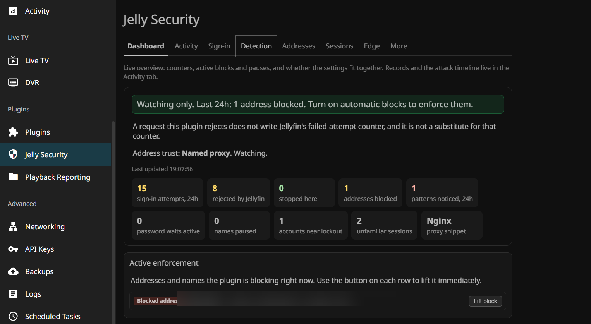
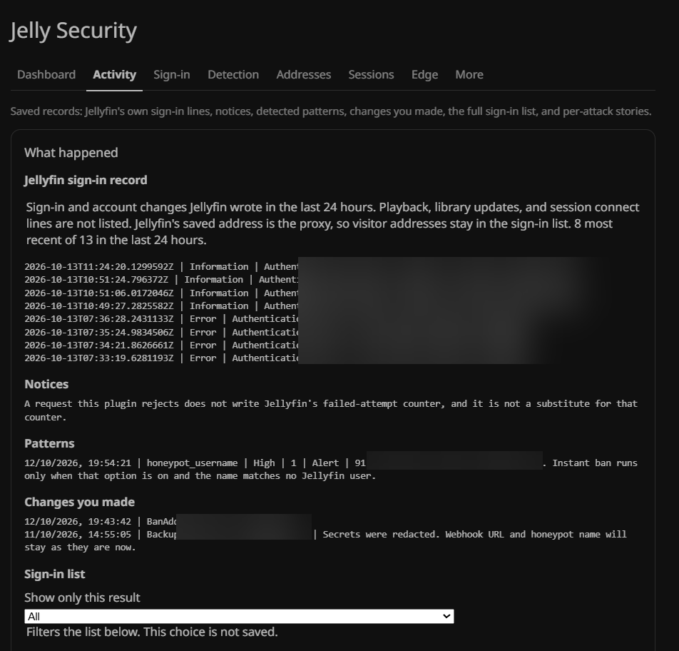
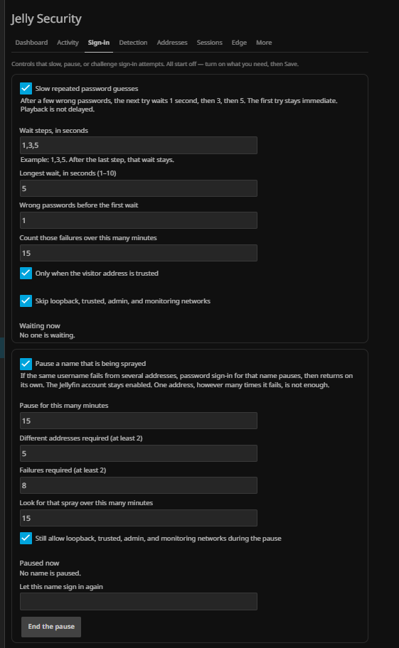
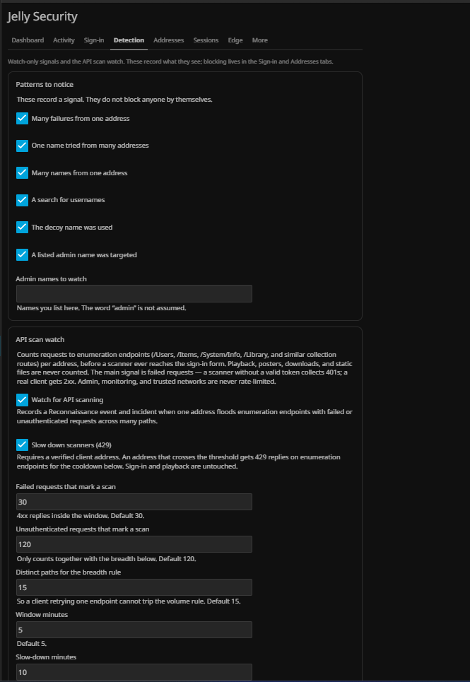
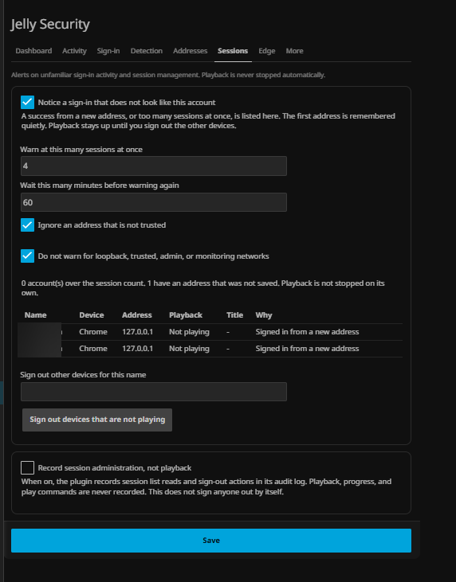
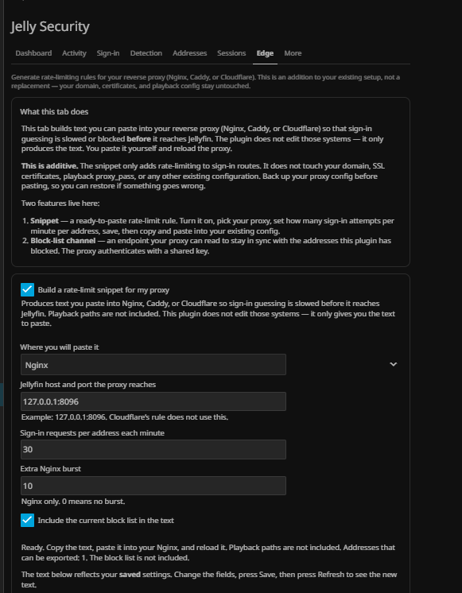
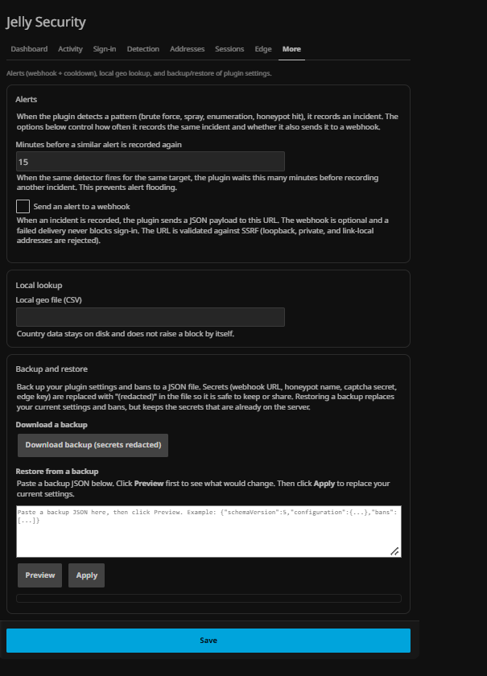
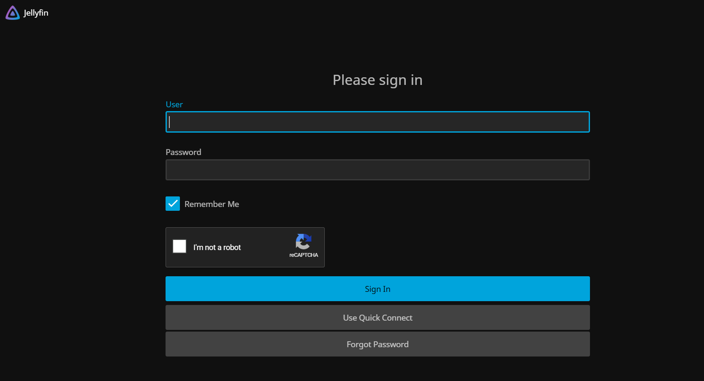
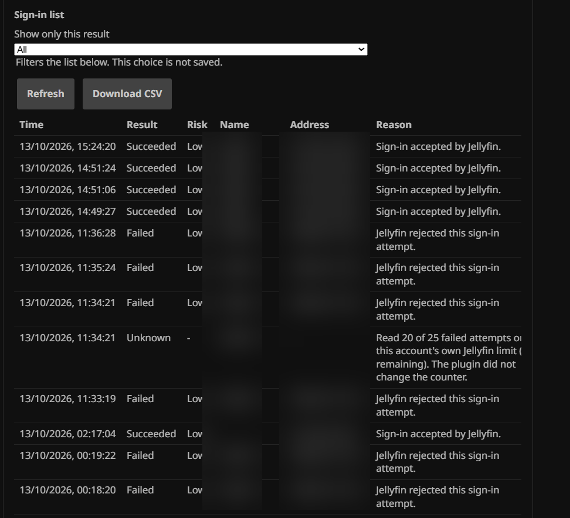

# Jelly Security

**Jelly Security** is a plugin for Jellyfin 12.2. It watches sign-in, keeps its own records, and can slow, pause, or block sign-in traffic when an administrator turns those options on.

Jellyfin still checks the password. The plugin does not replace users, passwords, or sessions. Playback is not classified, delayed, or stopped.

| | |
|---|---|
| Version | 0.21.0 |
| Jellyfin | 12.2.0 |
| Runtime | .NET 10 (`net10.0`) |
| Dashboard name | Jelly Security |
| License | [GPL-3.0-or-later](LICENSE) |

[العربية](README.ar.md) · [User guide](docs/USER_GUIDE.md) · [Technical guide](Jelly_Security.md) · [Changelog](CHANGELOG.md)

## Screenshots

| Dashboard | Activity records |
|---|---|
|  |  |

| Sign-in controls | Detection watches |
|---|---|
|  |  |

| Address blocking | Sessions |
|---|---|
|  |  |

| Edge snippets | Backup and alerts |
|---|---|
|  |  |

| CAPTCHA on the login form | Sign-in list |
|---|---|
|  |  |

## Dashboard

After installation, Jellyfin shows one page, **Jelly Security**, in the server menu. The page is English.

The page opens on what is happening now, then offers one choice per goal: slow password guesses, pause a sprayed name, warn before a Jellyfin lockout, notice an unfamiliar session, block an address, pause an address after repeated failures, ask the browser to confirm a person, treat a decoy name as enough, and copy a proxy limit. The numbers for a goal appear after that goal is turned on. Patterns, backups, and the sign-in history stay folded underneath.

An **Attack timeline** section groups failed and blocked sign-in attempts by source address into attack stories. Each story shows the chronological sequence of attempts, detected patterns, and any ban applied — so an administrator can read what happened from start to finish instead of scrolling a flat list.

The dashboard updates **live** via Server-Sent Events. When a sign-in event, ban, or incident fires, the page refreshes immediately — no 30-second wait. If SSE is unavailable (e.g. a proxy that buffers responses), the page falls back to 30-second polling.

Saving the form is what applies a change. Most extra controls start off.

## Controls

| Control | Default | What it does |
|---|---|---|
| Monitor Only | On | Records sign-in. Automatic IP bans stay off. |
| Manual bans | On | Enforces IPv4, IPv6, and CIDR bans an administrator creates. |
| Country blocks | Off | Blocks sign-in whose address matches a country row the administrator lists. Ranges stay editable text — fill from a local geo file or paste them. |
| Automatic IP bans | Off | Temporary bans only when the mode allows them and the client address is verified. |
| Browser challenge | Off | Google reCAPTCHA v2 or Cloudflare Turnstile on the browser sign-in and forgot-password forms. Apps and TV clients are not challenged. Unknown clients can be challenged too with an opt-in. |
| Device fingerprint | Off | An opt-in stricter client check. A bot that spoofs a TV app User-Agent is normally classified as an app and skips the challenge. Real Jellyfin apps always send a DeviceId in the authorization header. When this is on, a client claiming to be an app without a DeviceId is downgraded to Unknown — and when "Block unrecognized clients too" is also on, the spoofed app is challenged like a browser. |
| Password delay | Off | Waits 1s, then 3s, then 5s on repeated password failures. The ceiling is configurable. |
| Account cooldown | Off | Pauses one username inside the plugin after a distributed spray. It expires by itself and does not disable the Jellyfin user. |
| Honeypot ban | Off | One use of a decoy name that matches no user can ban that verified IPv4 address. |
| Lockout watch | Off | Reads each account's own Jellyfin lockout limit and failed-attempt count. It does not write either value. |
| Session watch | Off | Alerts on a new address or too many concurrent sessions. A button closes devices that are not playing. |
| Proxy snippet | Off | Text to paste into Nginx, Caddy, or Cloudflare. The plugin does not write those files. |
| Attack timeline | On | Groups failed and blocked sign-in attempts by source address into chronological attack stories. Read-only. |
| API scan watch | Off | Counts failed and unauthenticated requests to enumeration endpoints (/Users, /Items, /System/Info, /Library) per address, to spot reconnaissance before a sign-in attack. Records a Reconnaissance event and incident when a scan crosses the thresholds. Playback, posters, downloads, and static files are never counted. |
| Slow down scanners | Off | With the watch on, an address that crosses the scan threshold gets temporary 429 replies on enumeration endpoints for a configurable cooldown. Requires a verified client address. Admin, monitoring, and trusted networks are never limited. Sign-in and playback are untouched. |

A limit of -1, 0, or empty on a Jellyfin account means Jellyfin lockout is off for that account. The plugin does not use a fixed lockout number.

## Install

Jellyfin Server 12.2. In the dashboard, open **Plugins**, then **Repositories**, and add a repository:

| | |
|---|---|
| Repository name | Jelly Security |
| Repository URL | https://raw.githubusercontent.com/Rashid-config/Jelly_Security/main/manifest.json |

Save the repository, return to the catalog, and install **Jelly Security**. Jellyfin asks for a restart before the page appears. The page is named Jelly Security.

A Jellyfin 10.11 server needs a separate build. This one targets `net10.0`.

## Records

The plugin stores its own JSON files in its configuration directory: bans, events, audit, incidents, and known addresses. It does not write `jellyfin.db`.

Backups redact the webhook URL, the honeypot name, the captcha secret, and the edge key. Delay and cooldown counters are kept in memory and do not survive a restart. Bans and known addresses do.

## Scope

- Sign-in routes are classified. Playback URLs are not.
- The API scan watch counts only an allowlist of enumeration endpoints and never touches playback, images, downloads, or per-item routes. A real client browsing the library mostly gets 2xx with a token, so it stays under the thresholds; a scanner without one collects 401s. It is not a WAF — a patient scanner below the thresholds will not be noticed.
- A request the plugin rejects does not write Jellyfin's failed-attempt counter, and it is not a substitute for that counter.
- The browser challenge is for the web login form. Unknown clients skip it unless an admin opts in to challenging them too.
- Client classification reads the User-Agent and the Jellyfin authorization header. A spoofed app User-Agent is treated as an app unless the device fingerprint opt-in requires a real DeviceId.
- The admin-route map covers a known set of user and system write routes.
- The edge route uses a shared key. Jellyfin may still require its own authentication on that path.
- There is no second factor in this plugin.
- Country data does not raise the score. Threat lists are not downloaded.
- IPv6 addresses are not banned automatically by default. An admin can opt in to /64 prefix bans, which contain a whole end-user subnet instead of a single address.
- The plugin does not edit the firewall, Nginx, Caddy, or a Cloudflare account.
- The plugin does not disable Jellyfin users.

## FAQ

**Doesn't fail2ban already do this?**
For basic "ban an IP after N failures" on Linux, yes — fail2ban is a solid tool. This plugin exists for what fail2ban can't see: which username was tried, which client type, and whether the address is real behind a proxy or just a spoofed `X-Forwarded-For` header. It also runs on Windows, where fail2ban doesn't exist. They can run side by side — fail2ban at the OS level, this inside Jellyfin.

**How is this different from [JellyfinSecurity by ZL154](https://github.com/ZL154/JellyfinSecurity)?**
Different layer. That plugin adds a second factor — TOTP, passkeys, email OTP, OIDC/SSO — and extends Jellyfin's sign-in provider. This one never touches authentication: it's a traffic protection layer (pattern detection, bans, cooldowns, CAPTCHA) running as middleware. They solve different problems and can run side by side. If you want 2FA, use theirs — this plugin does not provide it.

**Doesn't Cloudflare already block countries?**
Only if your traffic is proxied through Cloudflare, which requires a domain you control on their nameservers. Free DDNS hostnames (DuckDNS, No-IP) can't go through Cloudflare at all. This plugin works inside Jellyfin, so it protects the server regardless of what's in front of it — Cloudflare, Nginx, Caddy, DDNS, or a raw IP.

**Does it work on TV apps and non-browser clients?**
Everything except the CAPTCHA does. Bans, password delay, account cooldown, pattern detection, and lockout watch all act on the sign-in requests themselves, regardless of client type. The CAPTCHA is web-only because a Roku or Firestick cannot render a challenge widget. Unknown clients (no recognizable User-Agent) can be challenged too with an opt-in, which closes the path for bots that send no UA at all. A second opt-in (device fingerprint) requires a real DeviceId for app classification — a bot that spoofs a TV User-Agent without sending a proper Jellyfin authorization header is then challenged too.

**Can the plugin lock me out of my own server?**
It is designed not to. A plugin error lets the request continue to Jellyfin rather than blocking it. Admin and monitoring networks are never banned, and automatic bans only ever apply to verified client addresses.

**Does it replace Jellyfin's login or store passwords?**
No. Jellyfin still checks every password. The plugin watches the traffic, keeps its own JSON records, and never touches `jellyfin.db`.

## Documentation

| Document | What it covers |
|---|---|
| [User guide](docs/USER_GUIDE.md) | Every tab, every field, every button — explained in plain language with examples and troubleshooting. Start here if you installed the plugin. |
| [Technical guide](Jelly_Security.md) | Code layout, HTTP API, settings schema, and design limits. Read this before changing the code. |
| [Changelog](CHANGELOG.md) | What changed in each release. |
| [Handoff](HANDOFF.md) | Context for anyone picking up development. |

## Development

```powershell
dotnet test Jellyfin.Plugin.JellySecurity.slnx -c Release
```

Contribution rules are in [CONTRIBUTING.md](CONTRIBUTING.md). Vulnerability reports stay private; see [SECURITY.md](SECURITY.md).

### Releasing

Releases are automated. Push a tag and GitHub Actions builds, tests, packages, computes the checksum, creates the release, uploads the zip, and updates `manifest.json`:

```
git tag v0.21.1.0
git push origin v0.21.1.0
```

The workflow runs on `ubuntu-latest` with .NET 10. The build and test steps run first — a failing test stops the release. The release zip contains only the plugin DLL, matching the manual process used for all prior releases.

## License

[GPL-3.0-or-later](LICENSE).
